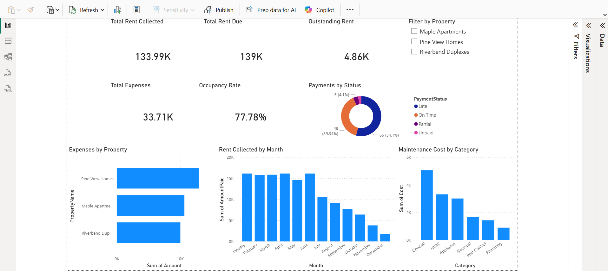
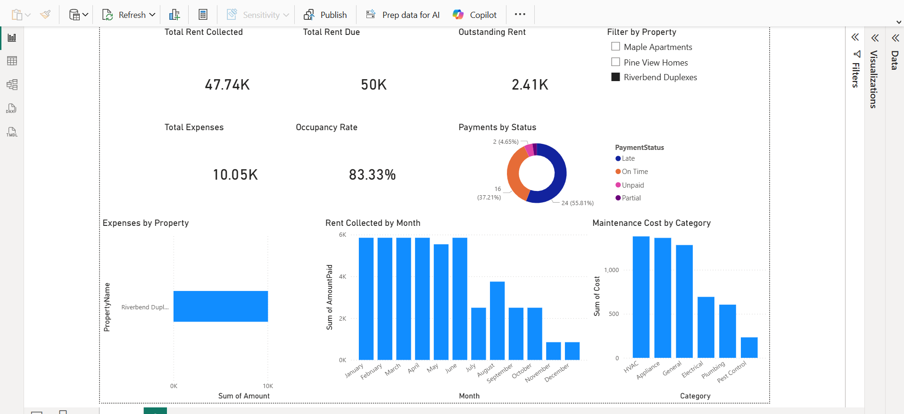

# Real Estate & Rental Analytics Dashboard

**Maintained by Ankit Choudhary**

An interactive Power BI dashboard designed to analyze rental property performance, rent collection, occupancy, expenses, and maintenance trends.

## Project Overview

The Rental Property Analytics Dashboard provides an overview of rental operations through interactive visualizations and key performance indicators. It helps property managers monitor financial performance, identify outstanding payments, and understand property-level trends.

## Project Objectives

- Monitor rent collection and outstanding payments.
- Analyze occupancy rates across properties.
- Track maintenance costs and operating expenses.
- Compare rental performance over time.
- Identify trends using interactive charts and filters.

## Tools & Technologies

- Microsoft Power BI
- Microsoft Excel
- GitHub

## Dataset

The project uses fictional sample rental property data containing:

- Properties
- Units
- Tenants
- RentPayments
- Maintenance
- Expenses

## Dashboard Features

- Total Rent Collected
- Total Rent Due
- Outstanding Rent
- Total Expenses
- Occupancy Rate
- Property-wise Expense Analysis
- Monthly Rent Collection
- Maintenance Cost by Category
- Payments by Status

## Dashboard Screenshots

### Main Dashboard

### Riverbend Duplexes Dashboard

## Key Insights

Based on the sample dataset:

- Overall occupancy rate: **77.78%**
- Total rent collected: **$133.99K**
- Outstanding rent: **$4.86K**
- Pine View Homes has the highest total expenses.
- General and HVAC are the highest maintenance cost categories.

## Project Files

| File | Description |
|---|---|
| `RentalPropertyDashboard.pbix` | Power BI dashboard |
| `rental_property_sample_data_.xlsx` | Sample dataset |
| `RentalPropertyDashboard.png` | Main dashboard screenshot |
| `RentalPropertyDashboardRiverbendDuplexes.png` | Property dashboard screenshot |

## Credits & Attribution

Repository maintained by **Ankit Choudhary**. This project is based on an existing rental property dashboard. Credit to the original creator should be retained.
